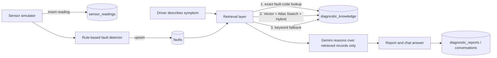

# 🚗 SimDoctor

**An AI vehicle doctor that watches a live sensor feed, catches the fault, and explains what to check, with every answer grounded in MongoDB Atlas.**

Built at Encode London 2026 for the *MongoDB Atlas: Build Anything, Change Everything* challenge.

<!-- Replace with a screenshot or GIF of the dashboard -->


> ⚠️ **Disclaimer:** No real car is connected. SimDoctor simulates the drive, and all fault limits are simulation thresholds, not manufacturer specifications. Output is a list of hypotheses to verify, never a confirmed diagnosis.

---

## The problem

A warning light comes on and most drivers have no idea what it means, how serious it is, or whether it is safe to keep driving. Diagnostic tools give you a code. They don't give you a plain-English answer you can trust.

## What SimDoctor does

1. **Streams a live drive.** Sensor readings (engine temperature, battery voltage, oil pressure, speed, RPM) arrive one at a time and are written to Atlas as they arrive.
2. **Catches faults in real time.** A rule-based detector flags readings that cross a limit, and the dashboard flips from green to red.
3. **Investigates.** The driver describes what they notice ("steam from the bonnet", "squealing when I brake"). SimDoctor retrieves the most relevant diagnostic knowledge from Atlas and asks Gemini to reason over that evidence.
4. **Produces a report.** Possible causes, urgency, safety warning, recommended checks, confidence statement and the evidence used. It can be saved to Atlas or downloaded as Markdown.
5. **Answers questions.** A chat assistant is grounded in the vehicle's latest readings, its detected faults and the knowledge base, and cites which records it used.

## MongoDB Atlas features used

| Feature | How SimDoctor uses it | Where |
|---|---|---|
| **Atlas Vector Search** | Semantic retrieval: "steam from under my bonnet" finds *Engine overheating* with no shared keywords | `search_modes.py`, `gemini_agent.py` |
| **Automated Embedding** (Voyage AI `voyage-4`) | The index embeds the `search_text` field for us. There is no embedding pipeline and no vectors stored in our code, and queries are plain text | `setup/create_indexes.py` |
| **Atlas Search** | Full-text, fuzzy keyword search (typos like "overheting" still match) over title, keywords and symptoms | `search_modes.py` |
| **Hybrid Search** | Vector and text results fused with Reciprocal Rank Fusion, using server-side `$rankFusion` with an in-app RRF fallback | `search_modes.py` |
| **Voyage AI reranking** | `$rerank` pipeline (Voyage `rerank-2.5`) implemented for MongoDB 8.3+ with native reranking enabled | `search_modes.py` |
| **Aggregation framework** | Fleet analytics: fault trends, vehicle health summaries and fault-to-report joins with `$group` and `$lookup` | `fault_trends.py`, `vehicle_health_summary.py`, `vehicle_fault_summary.py` |

### Collections (database `simdoctor`)

| Collection | Contents |
|---|---|
| `vehicles` | Fictional UK-style vehicles (registration, make, model, year, mileage) |
| `sensor_readings` | Every simulated reading, written as it arrives |
| `faults` | Detected faults, upserted once per reading and fault code |
| `diagnostic_knowledge` | 33 curated diagnostic records (symptoms, causes, checks, severity, keywords, `search_text`) |
| `diagnostic_reports` | Saved investigation reports |
| `conversations` | Every question and answer with the sources used |

## Architecture



**Retrieval strategy.** The detected fault's own record is always included first (exact lookup, so retrieval can never miss the obvious answer). Semantic matches are added only if their vector score passes a threshold, so weak matches don't pollute the answer. If Atlas is unreachable, a local keyword matcher takes over.

**Fails soft.** No Atlas gives demo mode. No Gemini gives a rule-based answer built from the stored knowledge. A vector search error falls back to exact lookup. The demo should never crash.

**Safety by design.** The model is told to use only the supplied readings and documents, to present causes as possibilities, to flag safety-critical faults, and to treat anything inside `<question>` and `<context>` tags as data rather than instructions (prompt-injection hardening). Evidence sentences in the report are built from real readings, never written by the AI.

## Features explained

### Dashboard (4 steps)
1. **Choose vehicle.** Pick a car from Atlas (or built-in demo vehicles).
2. **Drive simulation.** Pick a scenario (normal, overheating, low voltage, low oil) and start. 14 readings stream in, each saved to Atlas immediately. Sensor cards turn amber near a limit and red past it, and a live bar shows whether data was saved to Atlas.
3. **Describe the problem.** Type a symptom or use an example button, then press **Investigate**. A pipeline indicator tracks Evidence → Knowledge → AI reasoning → Report. Follow-up questions are supported in place.
4. **Your result.** A structured report with an urgency badge, safety warning and checks. An expandable **evidence panel** shows the sensor readings used, detected faults, retrieved records with scores, a side-by-side **Vector vs Atlas Search vs Hybrid comparison** with timings, and a plain-English reasoning trail explaining *why* the AI concluded what it did.

### Assistant
A chat page for free-form questions ("Is it safe to keep driving?", "What does low oil pressure mean?"). Each answer lists its sources, and every exchange is logged to `conversations`.

### Vehicles, History, Reports
Vehicle fleet table, per-vehicle sensor history charts and fault list, and every saved diagnostic report.

### Command-line tools (`main/`)
| Script | Purpose |
|---|---|
| `simulate_sensors.py` | Writes 10 readings with random fault injection (25% chance per reading) and stores detected faults |
| `fault_detector.py` | Rule engine (overheat >105 °C, battery <12.0 V, oil <1.0 bar) plus a backfill scan over recent readings |
| `diagnostic_reports.py` | Rule-based report generator (no AI) |
| `fault_trends.py` | Which faults occur most often and across how many vehicles |
| `vehicle_health_summary.py` | Per-vehicle max and average temperature, oil pressure, voltage and RPM |
| `vehicle_fault_summary.py` | Faults per vehicle joined to reports with `$lookup` |
| `search_modes.py "query"` | Compare all search modes from the terminal |

## Setup

**Prerequisites:** Python 3.10+, a MongoDB Atlas cluster (Automated Embedding and `$rankFusion` need a recent cluster), and optionally a [Gemini API key](https://aistudio.google.com/apikey).

```bash
git clone <your-repo-url> && cd SimDoctor
python -m venv .venv && source .venv/bin/activate   # Windows: .venv\Scripts\activate
pip install -r requirements.txt

cd main
cp .env.example .env        # then fill in MONGODB_URI and GEMINI_API_KEY

# One-time data setup (run from main/, in this order)
python setup/generate_vehicles.py     # fictional vehicles
python setup/seed_knowledge.py        # diagnostic knowledge base
python setup/prepare_vector_search.py # builds the search_text field
python setup/create_indexes.py        # vector + text indexes (wait ~1-3 min until READY in Atlas)

python -m streamlit run app.py
```

**Environment variables** (`main/.env`)

| Variable | Required | Notes |
|---|---|---|
| `MONGODB_URI` | Yes | Atlas connection string |
| `GEMINI_API_KEY` | No | Without it, answers fall back to stored guidance |
| `GEMINI_MODEL` | No | Pin a model (default `gemini-flash-latest`) |
| `EMBED_MODEL` | No | Default `voyage-4` (`voyage-4-lite` is cheaper) |

Try a quick terminal check: `python search_modes.py "steam coming from under my bonnet"`

## Demo script (3 minutes)

1. Start an **Overheating** drive and watch readings stream in and save to Atlas.
2. The dashboard flips red. Type *"smells hot after sitting in traffic"* and press **Investigate**.
3. Open the evidence panel and show vector vs lexical vs hybrid results, then the reasoning trail.
4. Try a symptom with no sensor fault ("squealing when I brake") to show semantic search finding it.
5. Save the report and open the **Reports** page. Show the collections in Atlas.

## Tech stack

Python · Streamlit · MongoDB Atlas (Vector Search, Atlas Search, Automated Embedding, `$rankFusion`, `$rerank`) · Voyage AI · Google Gemini · PyMongo · pandas

## Limitations and roadmap

- Sensor data is simulated, and the detector uses three fixed thresholds. Real OBD-II data and per-vehicle limits are the obvious next step.
- The knowledge base is a small curated set and should be reviewed by a qualified mechanic before real use.
- Next: Atlas Stream Processing for continuous windowed anomaly detection, rerank surfaced in the UI, per-vehicle history in retrieval, and a proper test suite.

## Team

Built at Encode London 2026 by *&lt;your names here&gt;*.
